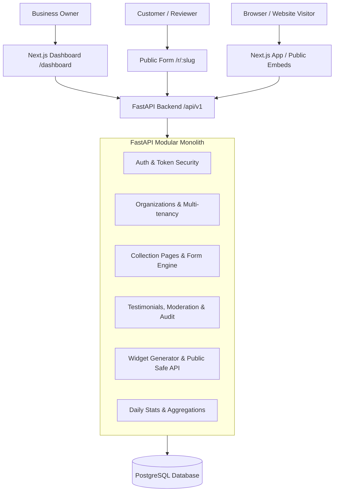
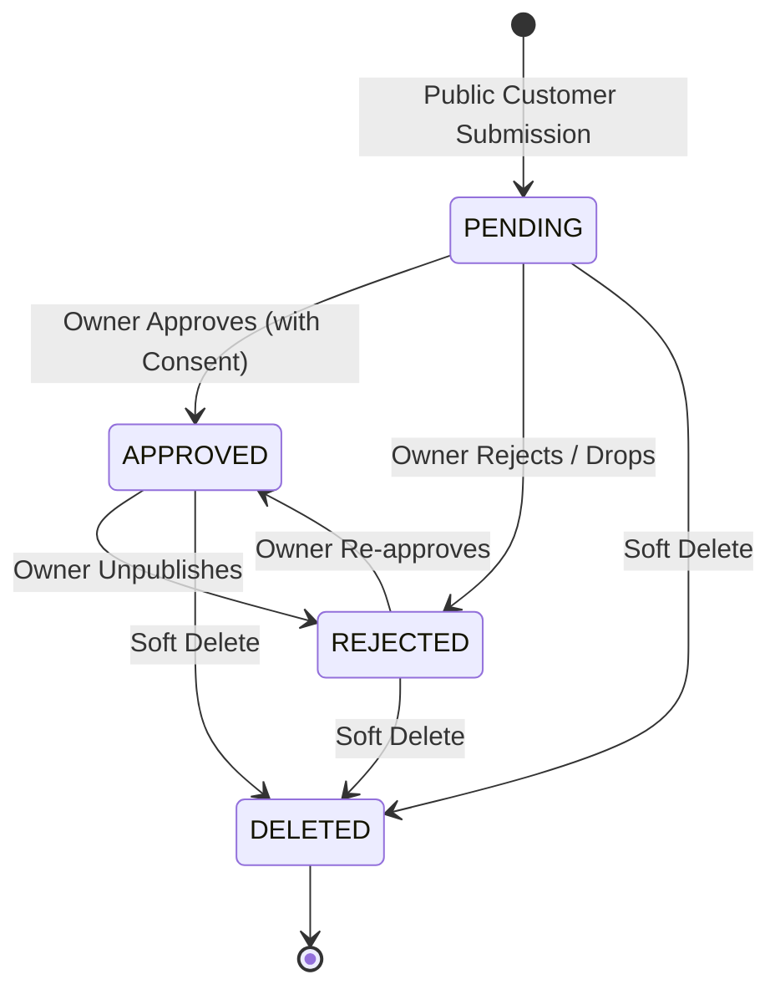

# Proofly — System Design & Architecture Document

MVP Architecture v1.0 · Multi-tenant SaaS

---

## 1. Architecture Overview

Proofly is engineered as a **modular monolith** with clean boundary separation between business domains. It utilizes:
- **FastAPI** for an asynchronous, strictly typed REST API.
- **PostgreSQL** (with SQLAlchemy 2.0 Async ORM and Alembic migrations) for durable relational persistence and tenant isolation.
- **Next.js 14+ (App Router)** for the dashboard, public review collection pages, and responsive embeddable iframe widgets.

---

## 2. Multi-Tenant Isolation Strategy

Proofly implements row-level tenant scoping enforced at the service and query layers:

1. **Composite Foreign Keys & Indices**:
   All tenant tables (`testimonials`, `collection_pages`, `widgets`, `audit_logs`, `daily_stats`) have an `organization_id` foreign key with cascade deletion.
2. **Context Resolution**:
   The dependency `get_current_org_context` inspects the caller's JWT token and header `X-Organization-Id`. It strictly verifies that the user is an active member in `organization_members` for the target tenant.
3. **No Unchecked Client Inputs**:
   Public submissions never specify `organization_id`; the API derives tenant ownership securely from the verified `CollectionPage.slug`.
4. **Query Scoping**:
   Every database query filters by `organization_id == ctx.organization_id` and checks `deleted_at IS NULL` for soft deletes.

---

## 3. Data Privacy & Abuse Protection

### Customer Email Privacy
- Reviewers may optionally submit their email address for private identity verification.
- **Rule**: Customer email is strictly withheld from any public endpoint. Public responses (`GET /api/v1/public/widgets/{id}`) return a sanitized `PublicTestimonialItem` model that contains only: `id`, `customer_name`, `customer_role`, `rating`, `content`, and `submitted_at`.

### Anti-Spam & Rate Limiting
- **Honeypot Field**: Form submissions include a hidden input (`website_hp`). If populated by automated bots, the submission is rejected without storing spam in the database.
- **IP-Based Rate Limiting**: An in-memory sliding-window limiter blocks IP addresses that exceed the configured threshold (default: 20 submissions per hour).
- **Explicit Consent**: Testimonials require an active `publish_consent: true` and timestamped record (`consent_at`, `consent_version`) before they can ever transition to `APPROVED` or appear on public widgets.

---

## 4. Moderation State Machine

Every state transition:
1. Verifies that `publish_consent == true` before permitting an `APPROVED` status.
2. Writes an immutable record to `audit_logs` capturing `actor_id`, `action`, `resource_id`, and transition timestamps within the same database transaction.
3. Immediately updates public cache / query availability.
